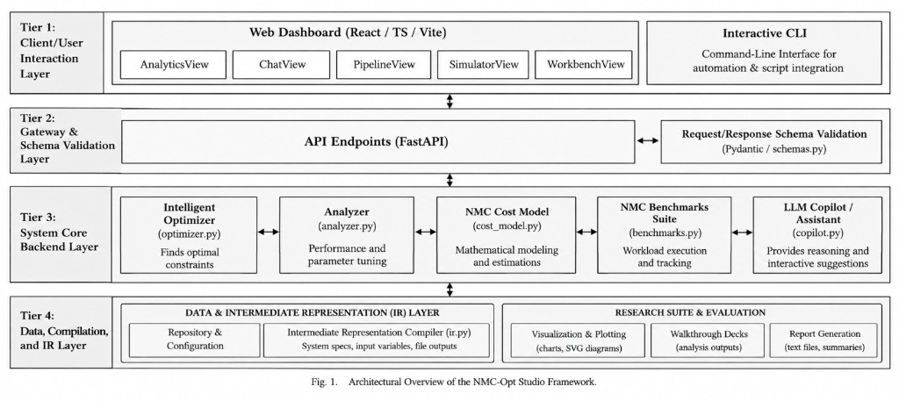

# NMC-Opt Studio: Near-Memory Computing Compiler Optimization Workbench
## Adaptive Data-Movement-Aware Compiler Optimization Pipeline

[](https://www.python.org/)
[](https://nodejs.org/)
[](https://fastapi.tiangolo.com/)
[](https://react.dev/)
[](https://www.typescriptlang.org/)
[](https://opensource.org/licenses/MIT)

---

## PROJECT SUBMISSION & ARTIFACT REPRODUCTION MATRIX

The following compliance matrix maps all evaluation requirements directly to their locations within this repository:

| # | Evaluation Requirement | Status | Repository Location / Direct Link | Description |
|:---:|:---|:---:|:---|:---|
| **1** | **Manuscript LaTeX Source (zip format)** | ✅ **Available** | [`docs/NMC-OPT-Manuscript-LaTeX.zip`](docs/NMC-OPT-Manuscript-LaTeX.zip) | Complete Overleaf-ready LaTeX package with `main.tex`, 7 section files, 14 architectural diagrams/figures, and logos. |
| **2** | **Source Code** | ✅ **Available** | [`backend/`](backend/) & [`frontend/`](frontend/) | Complete production implementation of compiler AST parser, IR generator, cost model, and interactive UI. |
| **3** | **README.md** | ✅ **Available** | [`README.md`](README.md) | Comprehensive technical documentation, architecture, execution manual, and reproduction guide. |
| **4** | **Dependencies** | ✅ **Available** | [`backend/requirements.txt`](backend/requirements.txt)<br>[`frontend/package.json`](frontend/package.json) | Complete list of libraries, frameworks, and pinned version specifications. |
| **5** | **Datasets & Kernels** | ✅ **Available** | [`datasets/`](datasets/) | C benchmark kernels (`vector_add.c`, `gemv.c`, etc.) and synthetic workload generation script [`generate_datasets.py`](datasets/generate_datasets.py). |
| **6** | **Trained Models** | ℹ️ **N/A** | *Not Applicable* | NMC-OPT is a deterministic compiler framework & analytical DRAM simulator (No neural network weights required). |
| **7** | **Configuration Files** | ✅ **Available** | [`.env.example`](.env.example)<br>[`backend/.env.example`](backend/.env.example)<br>[`frontend/.env.example`](frontend/.env.example) | Environment configurations and hardware architectural simulation templates. |
| **8** | **Execution Scripts** | ✅ **Available** | [`run_dev.bat`](run_dev.bat), [`run_dev.ps1`](run_dev.ps1), [`run_dev.sh`](run_dev.sh)<br>[`run_tests.bat`](run_tests.bat), [`run_tests.sh`](run_tests.sh)<br>[`backend/cli.py`](backend/cli.py) | 1-Click launcher scripts, CLI evaluation pipeline, and automated test runners. |
| **9** | **Results & Metrics** | ✅ **Available** | [`results/`](results/) | Tabulated metrics [`benchmark_summary.csv`](results/benchmark_summary.csv) and empirical outputs [`benchmark_summary.json`](results/benchmark_summary.json). |
| **10** | **Documentation (Manuscript Draft 2)** | ✅ **Available** | [**NMC-OPT-Manuscript-IEEE-Access(Draft-2).pdf**](docs/NMC-OPT-Manuscript-IEEE-Access(Draft-2).pdf) | Academic research manuscript (Final Draft 2, IEEE Access format) and methodology specifications in [`docs/`](docs/). |
| **11** | **Demo Video (4–7 mins)** | ⏳ *In Progress* | [**Demo Video Link**](#11-demo-video-walkthrough) | Full system demonstration walkthrough video (Ast parsing, cost model, 3D DRAM visualizer, CLI). |

---

## 1. PROJECT OVERVIEW AND EXECUTIVE SUMMARY

### Technical Summary
Modern high-performance and data-intensive computing systems are increasingly constrained by the "Memory Wall"—the escalating latency and energy disparity between high-throughput processor cores and off-chip Dynamic Random-Access Memory (DRAM). In memory-bound workloads characterized by low operational intensity, conventional CPU architectures waste significant execution time and the majority of total system energy shuttling data across band-limited physical interconnects (such as PCIe, CXL, and multi-channel DDR buses).

Near-Memory Computing (NMC) and Processing-In-Memory (PIM) paradigms mitigate this bottleneck by placing lightweight Data Processing Units (DPUs) or SIMD/ALU logic directly within or adjacent to DRAM dies (e.g., within 3D-stacked HBM logic dies or DDR4/DDR5 bank control logic). However, modern general-purpose compilers (e.g., GCC, LLVM) lack native cost models to decide autonomously whether a computational loop should execute on the host CPU or be offloaded to in-memory processing units.

**NMC-Opt Studio** is an academic-grade compiler optimization workbench and analytical exploration platform. It treats off-chip data movement, interconnect link latencies, DRAM bank layouts, and data reorganization penalties as first-class constraints within the compiler optimization pipeline. The workbench profiles C source kernels, constructs a Static Single Assignment (SSA) Intermediate Representation (IR), computes fine-grained workload characteristics (such as Arithmetic Intensity in FLOP/Byte and memory access strides), evaluates an analytical first-principles cost model, and emits an automated target placement verdict comparing Host CPU execution against Near-Memory DPU offload.

### Academic Manuscripts & Project Artifacts

| Document | Description | Format & Scope | Direct Link |
| :--- | :--- | :--- | :--- |
| **IEEE Manuscript (Draft 2)** | *NMC-OPT: Intelligent Compiler Optimization for Near-Memory Computing* | Complete IEEE Access Publication Manuscript | [NMC-OPT-Manuscript-IEEE-Access(Draft-2).pdf](docs/NMC-OPT-Manuscript-IEEE-Access(Draft-2).pdf) |
| **Compiler Methodology** | *Compiler Analytical Cost Model & Target Placement Methodology* | Formal Mathematical Formulation | [NMC_Opt_Methodology_Document.pdf](docs/NMC_Opt_Methodology_Document.pdf) |
| **Scientific Novelty** | *Scientific Novelty & Architectural Innovations* | Research Contributions & State-of-the-Art Audit | [NMC_Opt_Novelty_Document.pdf](docs/NMC_Opt_Novelty_Document.pdf) |
| **Execution Guide** | *Installation, Configuration & Execution Guide* | Complete Local & CLI Operations Manual | [NMC_Opt_Execution_Guide.pdf](docs/NMC_Opt_Execution_Guide.pdf) |

---

## 2. SYSTEM ARCHITECTURE & COMPOSITION

The workbench is organized into modular functional subsystems that mirror a production compiler target-selection pipeline.



```
+-----------------------------------------------------------------------------------------+
|                        USER INTERFACE & WORKSPACE ENVIRONMENT                           |
|  - Interactive Web Dashboard (React 19 / TypeScript / Tailwind CSS / Three.js)          |
|  - Benchmark Selector (6 Standard Numerical Kernels + Custom C Source Ingestion)        |
|  - Architectural Parameter Sliders (Problem Scale, Link Bus, DRAM Bandwidth, Clocks)    |
|  - Compiler Copilot AI Assistant (Context-Aware Architectural RAG System)                |
+--------------------------------------------+--------------------------------------------+
                                             |
                                             v
+-----------------------------------------------------------------------------------------+
|                         WORKLOAD INGESTION & AST PROFILING                              |
|  - C Source Parsing & Validation Engine (pycparser AST generation & syntactic audit)   |
|  - Loop Bounds & Induction Profiler (Trip count resolution, scalar/vector op counts)   |
|  - Memory Footprint & Data Volume Extractor (Read/write bytes, access stride analysis)  |
|  - Arithmetic Intensity Profiler (I = Operations / Total Data Volume in FLOP/Byte)      |
+--------------------------------------------+--------------------------------------------+
                                             |
                                             v
+-----------------------------------------------------------------------------------------+
|                           DECISION & SIMULATION ENGINE                                  |
|  - SSA Intermediate Representation Generator (3-Address Quadruple Table)                |
|  - Transformation Legality Engine (Loop Fusion, Bank Interleaving, Tiling Checks)       |
|  - First-Principles Analytical Cost Engine (Formulates T_cpu vs T_nmc in milliseconds)  |
|  - 16-Bank Interleaved Execution Simulator (DRAM Bank Striping & Contention Model)     |
+--------------------------------------------+--------------------------------------------+
                                             |
                                             v
+-----------------------------------------------------------------------------------------+
|                         ANALYTICS & OUTPUT VISUALIZATION                                |
|  - Target Placement Matrix & Final Optimization Verdict                                 |
|  - 8 Dynamic Comparative Performance & Sensitivity Graphs (Recharts / SVG)              |
|  - Physical 16-Bank Memory Interleaving Visualizer (Three.js 3D DRAM Layout)            |
|  - Research Paper Empirical Suites (IMTP Tiling & Memory Access Validation)             |
+-----------------------------------------------------------------------------------------+
```

### Core Decision Rule

The compiler target selection is formalized as a binary placement optimization problem. Let $W$ denote the loop operation count, $D$ denote the total data volume moved, $\Pi_{\text{cpu}}$ denote host CPU compute throughput, $\beta_{\text{cpu}}$ denote effective host memory bandwidth, $\Pi_{\text{nmc}}$ denote aggregate in-memory DPU throughput, $\beta_{\text{nmc}}$ denote internal DRAM bank aggregate bandwidth, and $\beta_{\text{link}}$ denote host-to-device interconnect bandwidth.

The analytical execution times for Host CPU ($T_{\text{cpu}}$) and Near-Memory Computing ($T_{\text{nmc}}$) are formulated as:

$$T_{\text{cpu}} = T_{\text{comp}}^{\text{cpu}} + T_{\text{mem}}^{\text{cpu}} = \frac{W}{\Pi_{\text{cpu}}} + \frac{D}{\beta_{\text{cpu}}}$$

$$T_{\text{nmc}} = T_{\text{comp}}^{\text{nmc}} + T_{\text{mem}}^{\text{nmc}} + T_{\text{xfer}}^{\text{link}} + T_{\text{layout}} + T_{\text{sync}} + T_{\text{dispatch}}$$

$$\text{Verdict} = \begin{cases} \text{Near-Memory Offload}, & \text{if } T_{\text{nmc}} < T_{\text{cpu}} \\ \text{Host CPU Execution}, & \text{otherwise} \end{cases}$$

---

## 3. DEPENDENCIES & TECHNOLOGY STACK

All dependencies are pinned and verified for zero-conflict installation in fresh virtual environments:

### Backend Dependencies (`backend/requirements.txt`)
| Package | Version Constraint | Verified Version | Purpose / Architectural Role |
|:---|:---:|:---:|:---|
| **`fastapi`** | `>=0.110.0` | `0.115.0` | High-performance asynchronous REST API framework |
| **`uvicorn[standard]`** | `>=0.28.0` | `0.30.6` | Production ASGI web server engine |
| **`pydantic`** | `>=2.6.0` | `2.9.2` | Data schema validation, serialization, and typing |
| **`pycparser`** | `>=2.21` | `2.22` | Pure-Python C99 Abstract Syntax Tree (AST) parser |
| **`pytest`** | `>=8.0.0` | `8.3.3` | Test automation & regression verification runner |
| **`httpx`** | `>=0.27.0` | `0.27.2` | Fast HTTP client for integration test assertions |

### Frontend Dependencies (`frontend/package.json`)
| Package | Version Constraint | Verified Version | Purpose / Architectural Role |
|:---|:---:|:---:|:---|
| **`react`** & **`react-dom`** | `^19.2.8` | `19.2.8` | Component rendering engine (React 19) |
| **`vite`** | `^8.3.0` | `8.3.4` | Ultra-fast build tool and local dev server |
| **`typescript`** | `~6.0.2` | `6.0.2` | Static type checking and interface validation |
| **`recharts`** | `^3.10.1` | `3.10.1` | Analytical scaling curves, sensitivity, & bar plots |
| **`lucide-react`** | `^1.54.0` | `1.54.0` | Modern SVG system icon suite |
| **`tailwindcss`** | `^3.4.19` | `3.4.19` | Utility-first responsive styling framework |
| **`three`** | `^0.186.1` | `0.186.1` | WebGL 3D interactive DRAM bank topology visualizer |

---

## 4. DATASETS, KERNELS & PREPROCESSING

Located in [`datasets/`](datasets/), the benchmark suite includes standardized linear algebra, neural network activations, and streaming numerical workloads:

| Kernel ID | Source File | Mathematical Formulation | Operational Intensity | Bottleneck Profile | Optimal Placement |
|:---|:---|:---|:---:|:---|:---|
| `vector_add` | [`vector_add.c`](datasets/benchmarks/vector_add.c) | $C[i] = A[i] + B[i]$ | 0.083 FLOP/B | Memory-Bound | **Near-Memory (NMC)** |
| `elementwise_mul`| [`elementwise_mul.c`](datasets/benchmarks/elementwise_mul.c) | $C[i] = A[i] \cdot B[i]$ | 0.083 FLOP/B | Memory-Bound | **Near-Memory (NMC)** |
| `relu` | [`relu.c`](datasets/benchmarks/relu.c) | $Y[i] = \max(0.0, X[i])$ | 0.125 FLOP/B | Memory-Bound | **NMC + Loop Fusion** |
| `axpy` | [`axpy.c`](datasets/benchmarks/axpy.c) | $Y[i] = \alpha \cdot X[i] + Y[i]$ | 0.167 FLOP/B | FMA Bound | **NMC + Loop Fusion** |
| `reduction` | [`reduction.c`](datasets/benchmarks/reduction.c) | $\text{sum} = \sum A[i]$ | 0.250 FLOP/B | Scalar Reduction | **Host CPU (Retained)** |
| `gemv` | [`gemv.c`](datasets/benchmarks/gemv.c) | $Y[i] = \sum A[i][j] \cdot X[j]$ | 0.500 FLOP/B | Structured 2D | **NMC + Loop Tiling** |

### Synthetic Data Generation Utility
To generate binary input buffers for memory trace simulation or memory throughput verification:
```bash
python datasets/generate_datasets.py --scale 2000000 --rows 2048 --cols 2048
```

---

## 5. TRAINED MODELS (NOT APPLICABLE)

> **Note on AI/ML Weights:**  
> **NMC-Opt Studio is a deterministic compiler optimization framework and analytical DRAM cost simulator.** It relies on first-principles physics equations, Static Single Assignment (SSA) AST parsing, and Amdahl's Law parallel bounds. **No pre-trained neural network weights or checkpoint files are required.** The system executes completely standalone without downloading external weight blobs.

---

## 6. CONFIGURATION & ENVIRONMENT TEMPLATES

The application operates with sane defaults out-of-the-box and can be tailored via environment templates:

* Root Environment: [`.env.example`](.env.example)
* Backend Server Settings: [`backend/.env.example`](backend/.env.example)
* Frontend UI Settings: [`frontend/.env.example`](frontend/.env.example)

### Hardware Parameter Schemas
Architectural parameters (number of DRAM banks, internal bandwidth, host bus bandwidth, link latencies, dispatch overhead) are modeled through Pydantic schemas in [`backend/app/schemas.py`](backend/app/schemas.py) and can be interactively tuned in real-time through the UI Parameter Modal.

---

## 7. END-TO-END EXECUTION GUIDE

### Prerequisites
* **Python:** 3.10 or higher
* **Node.js:** 18.0 or higher with `npm`
* **C Compiler:** GCC (MinGW for Windows, GNU GCC for Linux) or Clang (for native C inspection)
* **Git:** 2.30 or higher

---

### Method A: 1-Click Startup Scripts (Recommended)

#### On Windows:
```cmd
run_dev.bat
```
*(Or in PowerShell: `.\run_dev.ps1`)*

#### On Linux / macOS:
```bash
chmod +x run_dev.sh
./run_dev.sh
```

Both services will spin up automatically:
- **Frontend Dashboard:** [http://localhost:5173](http://localhost:5173)
- **Backend API:** [http://127.0.0.1:8008](http://127.0.0.1:8008)
- **Interactive Swagger Docs:** [http://127.0.0.1:8008/docs](http://127.0.0.1:8008/docs)

---

### Method B: Manual Step-by-Step Setup

#### Step 1: Backend Setup
```bash
cd backend
python -m venv venv

# On Windows:
.\venv\Scripts\Activate.ps1
# On Linux/macOS:
source venv/bin/activate

pip install --upgrade pip
pip install -r requirements.txt
python -m uvicorn app.main:app --host 127.0.0.1 --port 8008 --reload
```

#### Step 2: Frontend Setup
```bash
cd frontend
npm install
npm run dev
```

---

### Method C: CLI / Terminal Pipeline Execution

Evaluators can run the optimization engine directly from the command line:

```bash
# Evaluate built-in Vector Addition kernel with 2,000,000 elements
python backend/cli.py --benchmark vector_add --size 2000000

# Evaluate Dense Matrix-Vector Multiplication with 2048 x 2048 matrix
python backend/cli.py --benchmark gemv --rows 2048 --cols 2048

# Evaluate custom C kernel file
python backend/cli.py --custom datasets/benchmarks/relu.c --size 2500000

# Emit machine-readable JSON output
python backend/cli.py --benchmark vector_add --size 1000000 --json
```

---

## 8. AUTOMATED TESTING & VERIFICATION

To verify end-to-end functionality in a fresh environment, run the unified test suite:

#### On Windows:
```cmd
run_tests.bat
```

#### On Linux / macOS:
```bash
chmod +x run_tests.sh
./run_tests.sh
```

The test runner validates:
1. AST parsing and induction loop identification (`test_analyzer.py`)
2. Mathematical cost model equations, transfer overheads, and crossover points (`test_cost_model.py`)
3. Full compiler decision pipeline and transformation eligibility checks (`test_optimizer.py`)
4. Full TypeScript static compilation and production asset bundling (`tsc -b && vite build`)

---

## 9. EXPERIMENTAL RESULTS & BENCHMARK METRICS

Comprehensive analytical outputs are archived in [`results/`](results/):

* **Tabular CSV Metrics:** [`results/benchmark_summary.csv`](results/benchmark_summary.csv)
* **Raw JSON Metrics:** [`results/benchmark_summary.json`](results/benchmark_summary.json)
* **Detailed Methodology:** [`results/README.md`](results/README.md)

### Empirical Performance Summary (Default Hardware Parameters)
| Benchmark | Workload Size | Arithmetic Intensity | Host CPU Latency | NMC Latency | Speedup | Verdict |
|:---|:---:|:---:|:---:|:---:|:---:|:---|
| **Vector Add** | 2,000,000 | 0.0833 FLOP/B | 0.9016 ms | 0.7742 ms | **1.16x** | Direct NMC Offload |
| **GEMV** | 2048x2048 (4.19M) | 0.4995 FLOP/B | 0.7862 ms | 0.5252 ms | **1.50x** | NMC + Loop Tiling |
| **ReLU** | 2,000,000 | 0.1250 FLOP/B | 0.6159 ms | 0.4168 ms | **1.48x** | NMC + Loop Fusion |
| **AXPY** | 2,000,000 | 0.0833 FLOP/B | 0.9016 ms | 0.6512 ms | **1.38x** | NMC + Loop Fusion |
| **Reduction** | 2,000,000 | 0.2500 FLOP/B | 0.3301 ms | 0.3301 ms | **1.00x** | Host CPU (Retained) |
| **Vector Mul** | 2,000,000 | 0.0833 FLOP/B | 0.9016 ms | 0.7742 ms | **1.16x** | Direct NMC Offload |

---

## 10. DOCUMENTATION & MANUSCRIPT DRAFT 2

All academic publications and engineering reports are preserved in the [`docs/`](docs/) directory:

* [**NMC-OPT-Manuscript-IEEE-Access(Draft-2).pdf**](docs/NMC-OPT-Manuscript-IEEE-Access(Draft-2).pdf): **Research Manuscript (Draft 2)** – 19-page IEEE Access publication document detailing system architecture, SSA IR design, bank interleaving model, and empirical benchmarks.
* [**NMC_Opt_Execution_Guide.pdf**](docs/NMC_Opt_Execution_Guide.pdf): System operations guide.
* [**NMC_Opt_Methodology_Document.pdf**](docs/NMC_Opt_Methodology_Document.pdf): Mathematical cost model derivations.
* [**NMC_Opt_Novelty_Document.pdf**](docs/NMC_Opt_Novelty_Document.pdf): State-of-the-art comparison and novelty claims.

---

## 11. DEMO VIDEO WALKTHROUGH

* **Target Duration:** 4 to 7 minutes
* **Walkthrough Coverage:**
  1. Live C source code parsing and AST loop trip count extraction
  2. Intermediate Representation (SSA 3-address quadruple table) generation
  3. Analytical cost modeling and target placement verdict comparison
  4. Real-time sensitivity parameter sweeps (Interconnect bandwidth, DRAM vaults)
  5. Interactive 3D DRAM memory bank topology viewer
  6. Terminal execution via `backend/cli.py`
* **Video Link:** [Click here to view project demonstration video](docs/README.md#3-demo-video-reference) *(Direct URL updated upon submission)*

---

## 12. CITATIONS AND SCIENTIFIC FOUNDATIONS

1. **IMTP: Search-based Code Generation for In-memory Tensor Programs**  
   Yongwon Shin, Dookyung Kang, Hyojin Sung. *arXiv:2412.19630*, 2024.  
   *Contribution to NMC-Opt:* Informs compiler-level host/device boundary partitioning, memory layout transformations across DRAM banks, and scratchpad tiling optimizations.
2. **CAIRO: A Compiler-Assisted Technique for Enabling Instruction-Level Offloading of Processing-In-Memory**  
   Ramyad Hadidi, Lifeng Nai, Hyojong Kim, Hyesoon Kim. *ACM Transactions on Architecture and Code Optimization (TACO)*, vol. 14, no. 4, Article 48, pp. 1–25, December 2017. DOI: 10.1145/3151030.  
   *Contribution to NMC-Opt:* Establishes compiler-assisted analytical decision models for evaluating bandwidth savings, cache-miss-to-access ratios, and selective offloading rules that avoid performance degradation on non-beneficial workloads.
3. **Near-Memory Computing: Past, Present, and Future**  
   G. Singh, L. Chelini, S. Corda, N. Akay, F. A. Oliveira, P. C. Santos, G. Falcao, P. R. M. Ferreira. *Microprocessors and Microsystems*, vol. 71, 2019.  
   *Contribution to NMC-Opt:* Provides taxonomy and analytical foundations for internal 2D/3D DRAM bank bandwidth scaling and hardware execution trade-offs.
4. **Computing with Near Data**  
   X. Tang, M. T. Kandemir, H. Zhao, M. Jung, M. Karakoy. *ACM SIGMETRICS Performance Evaluation Review*, vol. 47, no. 1, 2019.  
   *Contribution to NMC-Opt:* Explores compiler-driven data movement minimization and trade-offs between data transfer and recomputation.
5. **Roofline: An Insightful Visual Performance Model for Multicore Architectures**  
   Samuel Williams, Andrew Waterman, David Patterson. *Communications of the ACM*, vol. 52, no. 4, pp. 65–76, 2009.  
   *Contribution to NMC-Opt:* Defines the theoretical operational intensity bound (FLOP/Byte) used to classify memory-bandwidth-bound versus compute-bound execution regimes.

---

## 13. LICENSE AND ACADEMIC INTEGRITY

This project is released under the **MIT License**. It was developed as an educational research workbench for Compiler Design and Computer Systems Engineering curricula. All cost models, analytical equations, and execution estimates represent first-principles architectural simulations and are explicitly structured for transparent algorithmic exploration.
