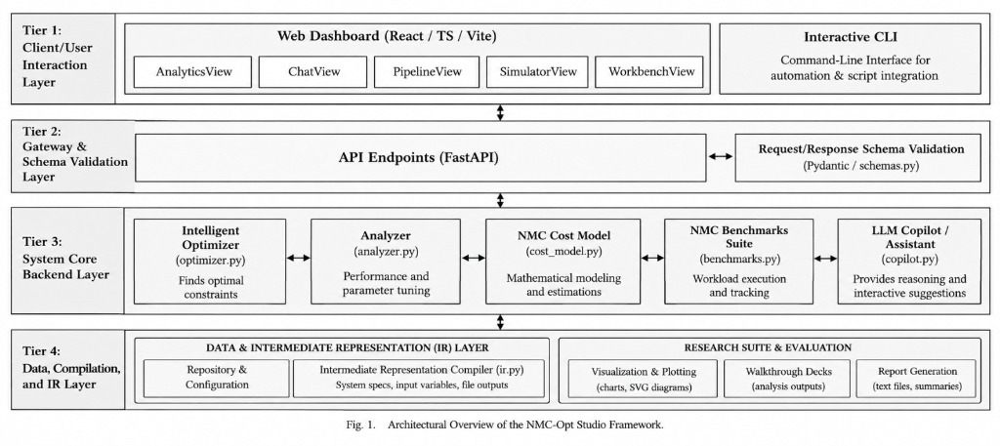

# NMC-Opt Studio: Near-Memory Computing Compiler Optimization Workbench
## Adaptive Data-Movement-Aware Compiler Optimization Pipeline

---

## 1. PROJECT OVERVIEW AND EXECUTIVE SUMMARY

### Technical Summary
Modern high-performance and data-intensive computing systems are increasingly constrained by the "Memory Wall"—the escalating latency and energy disparity between high-throughput processor cores and off-chip Dynamic Random-Access Memory (DRAM). In memory-bound workloads characterized by low operational intensity, conventional CPU architectures waste significant execution time and the majority of total system energy shuttling data across band-limited physical interconnects (such as PCIe, CXL, and multi-channel DDR buses).

Near-Memory Computing (NMC) and Processing-In-Memory (PIM) paradigms mitigate this bottleneck by placing lightweight Data Processing Units (DPUs) or SIMD/ALU logic directly within or adjacent to DRAM dies (e.g., within 3D-stacked HBM logic dies or DDR4/DDR5 bank control logic). However, modern general-purpose compilers (e.g., GCC, LLVM) lack native cost models to decide autonomously whether a computational loop should execute on the host CPU or be offloaded to in-memory processing units.

**NMC-Opt Studio** is an academic-grade compiler optimization workbench and analytical exploration platform. It treats off-chip data movement, interconnect link latencies, DRAM bank layouts, and data reorganization penalties as first-class constraints within the compiler optimization pipeline. The workbench profiles C source kernels, constructs a Static Single Assignment (SSA) Intermediate Representation (IR), computes fine-grained workload characteristics (such as Arithmetic Intensity in FLOP/Byte and memory access strides), evaluates an analytical first-principles cost model, and emits an automated target placement verdict comparing Host CPU execution against Near-Memory DPU offload.

---

## 2. SYSTEM ARCHITECTURE & COMPOSITION

The workbench is organized into modular functional subsystems that mirror a production compiler target-selection pipeline.



```
+-----------------------------------------------------------------------------------------+
|                        USER INTERFACE & WORKSPACE ENVIRONMENT                           |
|  - Interactive Web Dashboard (React 18 / TypeScript / Tailwind CSS)                     |
|  - Benchmark Selector (6 Standard Numerical Kernels + Custom C Source Ingestion)        |
|  - Architectural Parameter Sliders (Problem Scale, Link Bus, DRAM Bandwidth, Clocks)    |
|  - Compiler Copilot AI Assistant (Context-Aware Architectural RAG System)                |
+--------------------------------------------+--------------------------------------------+
                                             |
                                             v
+-----------------------------------------------------------------------------------------+
|                         WORKLOAD INGESTION & AST PROFILING                              |
|  - C Source Parsing & Validation Engine (pycparser AST generation & syntactic audit)   |
|  - Loop Bounds & Induction Profiler (Trip count resolution, scalar/vector op counts)   |
|  - Memory Footprint & Data Volume Extractor (Read/write bytes, access stride analysis)  |
|  - Arithmetic Intensity Profiler (I = Operations / Total Data Volume in FLOP/Byte)      |
+--------------------------------------------+--------------------------------------------+
                                             |
                                             v
+-----------------------------------------------------------------------------------------+
|                           DECISION & SIMULATION ENGINE                                  |
|  - SSA Intermediate Representation Generator (3-Address Quadruple Table)                |
|  - Transformation Legality Engine (Loop Fusion, Bank Interleaving, Tiling Checks)       |
|  - First-Principles Analytical Cost Engine (Formulates T_cpu vs T_nmc in milliseconds)  |
|  - 16-Bank Interleaved Execution Simulator (DRAM Bank Striping & Contention Model)     |
+--------------------------------------------+--------------------------------------------+
                                             |
                                             v
+-----------------------------------------------------------------------------------------+
|                         ANALYTICS & OUTPUT VISUALIZATION                                |
|  - Target Placement Matrix & Final Optimization Verdict                                 |
|  - 8 Dynamic Comparative Performance & Sensitivity Graphs (Chart.js / SVG)             |
|  - Physical 16-Bank Memory Interleaving Visualizer (Contiguous vs Bank-Parallel Layout) |
|  - Research Paper Empirical Suites (IMTP Tiling & Memory Access Validation)             |
+-----------------------------------------------------------------------------------------+
```

### Functional Subsystems

#### User Interface & Workspace Environment
The frontend workspace provides real-time interaction with the underlying compiler passes. It contains dynamic input controls allowing users to modulate workload sizes ($N = 100$ to $10^7$ elements), host-to-memory interconnect bandwidths, and internal bank frequencies. An integrated benchmark selector offers immediate access to six pre-tuned numerical kernels, alongside a drag-and-drop modal for arbitrary C loop ingestion. The workspace also integrates a Compiler Copilot assistant backed by a retrieval engine primed on compiler optimization theory, roofline modeling, and near-memory hardware constraints.

#### Workload Ingestion & AST Profiling
Source kernels written in C are processed through an Abstract Syntax Tree (AST) parser built atop `pycparser`. The static profiler inspects loop induction variables, trip counts, control-flow branching, array pointer offsets, and arithmetic operator frequencies. The module synthesizes a structured facts object quantifying:
- Total Floating-Point Operations ($W$)
- Data Traffic Volume ($D = \text{Bytes Read} + \text{Bytes Written}$)
- Arithmetic Intensity ($I = W / D$, measured in FLOP/Byte)
- Memory Access Classification (Streaming Sequential, Strided, or Matrix-Row)

#### Decision & Simulation Engine
The core compiler logic maps AST statements into a simplified Static Single Assignment (SSA) Intermediate Representation (IR) consisting of explicit three-address quadruples (`load`, `store`, `getelementptr`, `fadd`, `fmul`, `icmp`, `phi`, `br_cond`). 

Simultaneously, the engine executes an analytical cost evaluation using first-principles equations. It simulates memory channel mapping across a 16-bank interleaved PIM architecture, evaluating physical channel contention, bank conflict penalties, and layout transformation costs.

#### Analytics & Output Visualization
The reporting layer synthesizes compiler decisions into structured machine-readable outputs and visual components:
- Optimization Verdict: Quantitative placement recommendation with speedup ratios and dominant architectural bottlenecks.
- SSA IR Inspector: Interactive disassembly view showing line numbers, opcode mnemonics, operands, and compiler comments.
- Performance Graph Suite: Eight analytical plots visualizing scaling curves, breakdown stacks, energy metrics, and roofline operational points.
- 16-Bank Interleaved Layout Viewer: Interactive simulation depicting data distribution across independent DRAM banks and local DPUs.

### Core Decision Rule

The compiler target selection is formalized as a binary placement optimization problem. Let $W$ denote the loop operation count, $D$ denote the total data volume moved, $\Pi_{\text{cpu}}$ denote host CPU compute throughput, $\beta_{\text{cpu}}$ denote effective host memory bandwidth, $\Pi_{\text{nmc}}$ denote aggregate in-memory DPU throughput, $\beta_{\text{nmc}}$ denote internal DRAM bank aggregate bandwidth, and $\beta_{\text{link}}$ denote host-to-device interconnect bandwidth.

The analytical execution times for Host CPU ($T_{\text{cpu}}$) and Near-Memory Computing ($T_{\text{nmc}}$) are formulated as:

$$T_{\text{cpu}} = T_{\text{comp}}^{\text{cpu}} + T_{\text{mem}}^{\text{cpu}} = \frac{W}{\Pi_{\text{cpu}}} + \frac{D}{\beta_{\text{cpu}}}$$

$$T_{\text{nmc}} = T_{\text{comp}}^{\text{nmc}} + T_{\text{mem}}^{\text{nmc}} + T_{\text{link}} + T_{\text{layout}} + T_{\text{sync}}$$

Where:
$$T_{\text{comp}}^{\text{nmc}} = \frac{W}{\Pi_{\text{nmc}}}$$

$$T_{\text{mem}}^{\text{nmc}} = \frac{D}{\beta_{\text{nmc}}}$$

$$T_{\text{link}} = \frac{D_{\text{in}} + D_{\text{out}}}{\beta_{\text{link}}} + t_{\text{h2d}} + t_{\text{d2h}}$$

$$T_{\text{layout}} = \frac{D_{\text{reorganize}}}{\beta_{\text{layout}}} + t_{\text{layout}}$$

$$T_{\text{sync}} = S \cdot t_{\text{barrier}}$$

**Formal Placement Rule:**
$$\text{Placement Target} = \begin{cases} \mathbf{In\text{-}Memory\ DPU\ (NMC)} & \text{if } T_{\text{nmc}} < T_{\text{cpu}} \iff I < I_{\text{crossover}} \\ \mathbf{Host\ CPU} & \text{otherwise} \end{cases}$$

When the kernel's arithmetic intensity $I$ is below the physical crossover threshold $I_{\text{crossover}}$, internal DRAM bank parallelism ($\beta_{\text{nmc}} \gg \beta_{\text{cpu}}$) amortizes the PCIe/CXL transfer penalty ($T_{\text{link}}$), producing net speedup. When $I \ge I_{\text{crossover}}$, compute intensity dominates, and the superior vector ALUs of the host CPU ($\Pi_{\text{cpu}} > \Pi_{\text{nmc}}$) dictate CPU retention.

---

## 3. HARDWARE & COMPILER PARAMETERS SPECIFICATION

All analytical models, simulation passes, and optimization thresholds are fully parameterized and configurable. The default parameters represent modern DDR5 / HBM3-PIM enterprise systems connected via PCIe Gen5 x16 or CXL 3.0 links.

| Parameter Identifier | Variable Name | Default Value | Valid Range | Unit | Architectural Description |
| :--- | :--- | :--- | :--- | :--- | :--- |
| Problem Scale | `input_size` ($N$) | 2,000,000 | 100 to 100,000,000 | Elements | Total number of array elements processed by the kernel. |
| Matrix Dimension: Rows | `matrix_rows` ($M$) | 2,048 | 4 to 65,536 | Rows | Row dimension for dense matrix-vector operations (GEMV). |
| Matrix Dimension: Columns | `matrix_cols` ($K$) | 2,048 | 4 to 65,536 | Columns | Column dimension for dense matrix-vector operations (GEMV). |
| Host CPU Compute Peak | `cpu_compute_gflops` ($\Pi_{\text{cpu}}$) | 45.0 | 1.0 to 500.0 | GFLOPS | Effective vector floating-point throughput of host CPU cores. |
| Host DRAM Bus Bandwidth | `cpu_effective_bandwidth_gbps` ($\beta_{\text{cpu}}$) | 28.0 | 1.0 to 128.0 | GB/s | Sustained streaming memory bandwidth across host memory channels. |
| NMC Aggregate Compute Peak | `nmc_compute_gflops` ($\Pi_{\text{nmc}}$) | 32.0 | 1.0 to 256.0 | GFLOPS | Total aggregate compute throughput across all DRAM in-memory DPUs. |
| Internal DRAM Bank Bandwidth | `nmc_effective_bandwidth_gbps` ($\beta_{\text{nmc}}$) | 160.0 | 1.0 to 1024.0 | GB/s | Ultra-wide aggregate internal bandwidth across all 16 DRAM banks. |
| Interconnect Link Bandwidth | `host_link_bandwidth_gbps` ($\beta_{\text{link}}$) | 64.0 | 1.0 to 256.0 | GB/s | Effective unidirectional bandwidth of host bus (PCIe Gen5 x16 / CXL). |
| Host-to-Device Dispatch Overhead | `host_to_nmc_overhead_ms` ($t_{\text{h2d}}$) | 0.020 | 0.0 to 5.0 | ms | Software driver, MMIO register write, and DMA setup latency. |
| Device-to-Host Return Overhead | `nmc_to_host_overhead_ms` ($t_{\text{d2h}}$) | 0.020 | 0.0 to 5.0 | ms | Interrupt handling, completion notification, and return DMA latency. |
| Layout Conversion Overhead | `layout_conversion_overhead_ms` ($t_{\text{layout}}$) | 0.020 | 0.0 to 5.0 | ms | In-memory layout transposition and strided rearrangement launch tax. |
| Layout Conversion Bandwidth | `layout_conversion_bandwidth_gbps` ($\beta_{\text{layout}}$) | 48.0 | 1.0 to 256.0 | GB/s | Throughput of memory-side scatter/gather layout transformation. |
| Synchronization Barrier Overhead | `synchronization_overhead_ms` ($t_{\text{barrier}}$) | 0.010 | 0.0 to 5.0 | ms | Global hardware barrier latency across all participating DRAM DPUs. |
| Synchronization Event Count | `sync_events` ($S$) | 1 | 1 to 16 | Events | Number of cross-bank synchronization points per kernel execution. |
| Bank Count | `bank_count` ($B$) | 16 | 4 to 64 | Banks | Number of independent physical DRAM banks hosting embedded ALUs. |
| DPU Clock Frequency | `pim_frequency_mhz` ($f_{\text{dpu}}$) | 500 | 200 to 1200 | MHz | Operating clock frequency of near-memory execution units. |
| Arithmetic Intensity Threshold | `I_crossover` | Calculated | 0.05 to 2.50 | FLOP/Byte | Workload-dependent intensity threshold below which NMC offload wins. |

---

## 4. ANALYTICAL GRAPH & METRIC EVALUATION GUIDE

The platform computes and renders eight dynamic analytical figures that characterize performance, energy dissipation, and sensitivity frontiers.

### Graph 1: Candidate Strategy Latency
- **Objective:** Compares end-to-end execution time (in milliseconds) across all candidate compiler targets: CPU-Only Baseline, Direct NMC Offload, NMC with Loop Fusion, and NMC with Loop Tiling.
- **Operational Interpretation:** Evaluates the relative speedup:
  $$\text{Speedup} = \frac{T_{\text{cpu}}}{T_{\text{nmc}}}$$
  A strategy is marked invalid if transformation legality preconditions fail (e.g., tiling an unnested 1D vector loop).

### Graph 2: Input Size Scaling & Crossover Curve
- **Objective:** Plots execution latency on a log-log scale as input elements scale from $N = 2^{12}$ (4,096) to $N = 2^{24}$ (16,777,216).
- **Operational Interpretation:** Identifies the physical break-even point ($N_{\text{crossover}}$). At small scales, constant dispatch overheads ($t_{\text{h2d}} + t_{\text{d2h}}$) dominate $T_{\text{nmc}}$, making CPU execution faster. Beyond $N_{\text{crossover}}$, the high slope of $T_{\text{cpu}}$ (governed by $D / \beta_{\text{cpu}}$) causes it to exceed $T_{\text{nmc}}$, cementing NMC superiority.

### Graph 3: Fine-Grained Latency Component Breakdown
- **Objective:** Decomposes total execution time into a stacked representation of constituent architectural phases:
  1. Pure Computation ($T_{\text{comp}}$)
  2. Interconnect DMA Transfer ($T_{\text{link}}$)
  3. Internal DRAM Bank Access ($T_{\text{mem}}$)
  4. Layout Rearrangement ($T_{\text{layout}}$)
  5. Inter-Bank Barrier Synchronization ($T_{\text{sync}}$)
- **Operational Interpretation:** Informs compiler engineers whether an offload strategy is bottlenecked by bus transfers or by internal memory bank throughput.

### Graph 4: Data Movement Energy Dissipation
- **Objective:** Quantifies system energy consumption (measured in millijoules, mJ) partitioned into computational ALU energy and data movement energy.
- **Operational Interpretation:** Off-chip DDR channel routing dissipates approximately $15.0 \text{ to } 25.0 \text{ pJ/bit}$ due to high capacitive PCB traces. Internal 3D TSV and near-bank transfers dissipate only $1.5 \text{ to } 3.0 \text{ pJ/bit}$. The graph highlights up to $80\%\text{--}90\%$ energy reduction for low-intensity memory-bound kernels.

### Graph 5: Classical Roofline Model Operational Point
- **Objective:** Projects the kernel's arithmetic intensity ($I = \text{FLOP/Byte}$) against the dual-ceiling roofline model representing maximum machine capability:
  $$\text{Attainable Performance} = \min\left(\Pi_{\text{peak}},\ I \cdot \beta_{\text{peak}}\right)$$
- **Operational Interpretation:** Depicts the inflection point ($I_{\text{knee}} = \Pi / \beta$). Kernels falling to the left of the knee are memory-bandwidth-bound, confirming theoretical viability for NMC offload.

### Graph 6: PCIe/CXL Link Bandwidth Sensitivity
- **Objective:** Evaluates total offload execution time as interconnect bandwidth sweeps across standard link profiles: Gen3 x16 (16 GB/s), Gen4 x16 (32 GB/s), Gen5 x16 (64 GB/s), and CXL 3.0 Fabric (128 GB/s).
- **Operational Interpretation:** Visualizes how increasing interconnect throughput contracts link transfer time ($T_{\text{link}}$) and shifts the crossover point $N_{\text{crossover}}$ toward smaller dataset sizes.

### Graph 7: DRAM Bank Contention & Layout Penalty
- **Objective:** Contrasts memory access latency under non-interleaved (single-channel serialized) versus 16-bank interleaved memory striping.
- **Operational Interpretation:** Illustrates bank conflict penalties caused by stride-induced channel collisions. Demonstrates why compiler-driven layout transformation passes are essential to unlock peak bank-level parallelism ($B \times \beta_{\text{single\_bank}}$).

### Graph 8: Parallel DPU Strong Scaling Efficiency
- **Objective:** Analyzes speedup scaling and parallel efficiency as available near-memory DPUs scale from 64 to 2,048 cores across DRAM ranks.
- **Operational Interpretation:** Applies Amdahl's Law to model parallel degradation caused by non-parallelizable host setup latencies and sequential scalar aggregation (e.g., root reduction in tree reduction kernels).

---

## 5. END-TO-END EXECUTION GUIDE

This guide provides step-by-step instructions for cloning, configuring, and executing NMC-Opt Studio in a local development environment.

### Prerequisites
Ensure the host development environment meets the following baseline requirements:
- **Python:** Version 3.10 or higher (Python 3.11, 3.12, 3.13, and 3.14 verified)
- **Node.js:** Version 18.0 or higher with `npm` (Node.js 20+ recommended)
- **C Compiler:** GCC (MinGW for Windows, GNU GCC for Linux) or Clang (required for local native C compilation audits)
- **Git:** Version 2.30 or higher

---

### Step 1: Repository Cloning & Environment Initialization

Open a terminal or PowerShell session and clone the repository:

```bash
git clone https://github.com/MSN-1307/NMC-OPT-CD.git
cd NMC-OPT-CD
```

Verify directory structure:
```
NMC-OPT-CD/
|-- backend/
|   |-- app/
|   |   |-- analyzer.py
|   |   |-- benchmarks.py
|   |   |-- copilot.py
|   |   |-- cost_model.py
|   |   |-- ir.py
|   |   |-- main.py
|   |   |-- optimizer.py
|   |   |-- research_suite.py
|   |   `-- schemas.py
|   |-- tests/
|   |-- cli.py
|   `-- requirements.txt
|-- frontend/
|   |-- src/
|   |-- package.json
|   `-- vite.config.ts
`-- README.md
```

---

### Step 2: Backend Setup

Navigate to the `backend` directory, initialize a Python virtual environment, install all dependencies, and launch the FastAPI server.

#### On Windows (PowerShell):
```powershell
cd backend
python -m venv venv
.\venv\Scripts\Activate.ps1
python -m pip install --upgrade pip
pip install -r requirements.txt
python -m uvicorn app.main:app --host 127.0.0.1 --port 8008 --reload
```

#### On Linux / macOS:
```bash
cd backend
python3 -m venv venv
source venv/bin/activate
python3 -m pip install --upgrade pip
pip install -r requirements.txt
python3 -m uvicorn app.main:app --host 127.0.0.1 --port 8008 --reload
```

#### API Verification:
- OpenAPI / Swagger Interactive Documentation: `http://localhost:8008/docs`
- Health Check Endpoint: `http://localhost:8008/api/health`

---

### Step 3: Frontend Setup

Open a separate terminal session, navigate to the `frontend` directory, install Node dependencies, and start the Vite development server.

```bash
cd frontend
npm install
npm run dev
```

The frontend application will start and serve at:
```
http://localhost:5173
```

---

### Step 4: CLI / Terminal Pipeline Execution

In addition to the interactive web dashboard, the compiler optimization engine can be executed directly via the command-line interface.

#### 1. Evaluating Built-In Benchmarks:
Execute the CLI tool to evaluate standard kernels with custom dataset sizes:

```bash
# Evaluate Vector Addition with 2,000,000 elements
python backend/cli.py --benchmark vector_add --size 2000000

# Evaluate Matrix-Vector Multiplication with 2048 x 2048 matrix
python backend/cli.py --benchmark gemv --size 4194304 --rows 2048 --cols 2048

# Evaluate ReLU Activation with 5,000,000 elements
python backend/cli.py --benchmark relu --size 5000000
```

#### 2. Evaluating Custom C Source Kernels:
Create an arbitrary single-loop C file (e.g., `kernel.c`):

```c
// kernel.c
void saxpy_loop(const float* X, float* Y, float a, int N) {
    for (int i = 0; i < N; ++i) {
        Y[i] = a * X[i] + Y[i];
    }
}
```

Run the pipeline against the custom kernel:

```bash
python backend/cli.py --custom kernel.c --size 4000000
```

#### 3. Emitting Raw JSON Output:
Append `--json` to integrate with external automated pipelines:

```bash
python backend/cli.py --benchmark vector_add --size 1000000 --json
```

#### 4. Direct HTTP API Evaluation:
You can also trigger optimization directly using `curl`:

```bash
curl -X POST "http://127.0.0.1:8008/api/analyze" \
     -H "Content-Type: application/json" \
     -d '{"benchmark_id": "vector_add", "input_size": 2000000}'
```

---

### Step 5: Verification & Output Validation

To ensure algorithmic correctness and verify regression safety across all compiler modules, execute the automated backend test suite:

```bash
cd backend
python -m pytest tests -v
```

To verify frontend TypeScript integrity and production bundling:

```bash
cd frontend
npm run build
```

---

## 6. BENCHMARK SUITE & C SOURCE KERNELS

NMC-Opt Studio incorporates six standard numerical workloads spanning diverse operational intensity and access characteristics.

### 1. Vector Addition (VADD)
- **Mathematical Form:** $C[i] = A[i] + B[i]$
- **Operational Metrics:** 1 FLOP / 12 Bytes moved $\implies I = 0.0833\text{ FLOP/Byte}$
- **Access Pattern:** Contiguous, sequential streaming across three distinct 1D arrays.
- **Compiler Assessment:** Severely memory-bandwidth-bound. Ideal candidate for direct NMC offload; eliminates round-trip bus saturation.
```c
void vector_add(const float* A, const float* B, float* C, int N) {
    #pragma loop_bound min(100) max(10000000)
    for (int i = 0; i < N; ++i) {
        C[i] = A[i] + B[i];
    }
}
```

### 2. Vector Sum Reduction
- **Mathematical Form:** $\text{sum} = \sum_{i=0}^{N-1} A[i]$
- **Operational Metrics:** 1 FLOP / 4 Bytes read $\implies I = 0.2500\text{ FLOP/Byte}$
- **Access Pattern:** Contiguous sequential stream producing a single scalar output.
- **Compiler Assessment:** Asymmetric bandwidth demand: massive input stream, negligible return traffic (4 bytes). Optimized via parallel two-phase tree reduction across in-memory bank DPUs with final scalar aggregation on host CPU.
```c
float vector_reduction(const float* A, int N) {
    float sum = 0.0f;
    for (int i = 0; i < N; ++i) {
        sum += A[i];
    }
    return sum;
}
```

### 3. ReLU Activation
- **Mathematical Form:** $Y[i] = \max(0.0, X[i])$
- **Operational Metrics:** 1 Comparison / 8 Bytes moved $\implies I = 0.1250\text{ OP/Byte}$
- **Access Pattern:** 1D streaming unary transformation.
- **Compiler Assessment:** Zero arithmetic reuse. Highly memory-bound on CPU bus. Candidate for in-memory branchless CMOV or adjacent-layer loop fusion.
```c
void relu_kernel(const float* X, float* Y, int N) {
    for (int i = 0; i < N; ++i) {
        Y[i] = (X[i] > 0.0f) ? X[i] : 0.0f;
    }
}
```

### 4. Matrix-Vector Product (GEMV)
- **Mathematical Form:** $Y[i] = \sum_{j=0}^{M-1} A[i \cdot M + j] \cdot X[j]$
- **Operational Metrics:** $2NM\text{ FLOPs} / (4NM + 4M + 4N)\text{ Bytes} \implies I \approx 0.5000\text{ FLOP/Byte}$
- **Access Pattern:** Dense 2D row-major matrix streaming with repeated vector $X$ reads.
- **Compiler Assessment:** Moderate intensity. Requires row-tiling and bank-interleaved memory layout transformations to prevent bank conflict stalls and exploit local PIM register reuse.
```c
void gemv_kernel(const float* A, const float* X, float* Y, int N, int M) {
    for (int i = 0; i < N; ++i) {
        float sum = 0.0f;
        for (int j = 0; j < M; ++j) {
            sum += A[i * M + j] * X[j];
        }
        Y[i] = sum;
    }
}
```

### 5. AXPY (Scaled Vector Add)
- **Mathematical Form:** $Y[i] = \alpha \cdot X[i] + Y[i]$
- **Operational Metrics:** 2 FLOPs (1 Multiply, 1 Add) / 12 Bytes moved $\implies I = 0.1667\text{ FLOP/Byte}$
- **Access Pattern:** Two vector streams (one read-only, one read-write).
- **Compiler Assessment:** Fused Multiply-Add (FMA) target. Offloading avoids two round trips to host cache hierarchy by updating $Y[i]$ directly within DRAM bank ALUs.
```c
void axpy(float alpha, const float* X, float* Y, int N) {
    #pragma loop_bound min(100) max(16777216)
    for (int i = 0; i < N; ++i) {
        Y[i] = alpha * X[i] + Y[i];
    }
}
```

### 6. Element-wise Vector Multiply
- **Mathematical Form:** $C[i] = A[i] \cdot B[i]$
- **Operational Metrics:** 1 FLOP / 12 Bytes moved $\implies I = 0.0833\text{ FLOP/Byte}$
- **Access Pattern:** Dual streaming read, single streaming write.
- **Compiler Assessment:** Mirror profile of Vector Addition. Constrained exclusively by memory channel throughput; exhibits linear scaling with internal DRAM bank bandwidth.
```c
void elementwise_mul(const float* A, const float* B, float* C, int N) {
    #pragma loop_bound min(100) max(16777216)
    for (int i = 0; i < N; ++i) {
        C[i] = A[i] * B[i];
    }
}
```

---

## 7. CITATIONS AND SCIENTIFIC FOUNDATIONS

The theoretical and analytical formulations embodied within NMC-Opt Studio draw upon foundational literature in computer architecture, memory-centric systems, and compiler design:

1. **IMTP: Search-based Code Generation for In-memory Tensor Programs**  
   Yongwon Shin, Dookyung Kang, Hyojin Sung. *arXiv:2412.19630*, 2024.  
   *Contribution to NMC-Opt:* Informs compiler-level host/device boundary partitioning, memory layout transformations across DRAM banks, and scratchpad tiling optimizations.
2. **CAIRO: A Compiler-Assisted Technique for Enabling Instruction-Level Offloading of Processing-In-Memory**  
   Ramyad Hadidi, Lifeng Nai, Hyojong Kim, Hyesoon Kim. *ACM Transactions on Architecture and Code Optimization (TACO)*, vol. 14, no. 4, Article 48, pp. 1–25, December 2017. DOI: 10.1145/3151030.  
   *Contribution to NMC-Opt:* Establishes compiler-assisted analytical decision models for evaluating bandwidth savings, cache-miss-to-access ratios, and selective offloading rules that avoid performance degradation on non-beneficial workloads.
3. **Near-Memory Computing: Past, Present, and Future**  
   G. Singh, L. Chelini, S. Corda, N. Akay, F. A. Oliveira, P. C. Santos, G. Falcao, P. R. M. Ferreira. *Microprocessors and Microsystems*, vol. 71, 2019.  
   *Contribution to NMC-Opt:* Provides taxonomy and analytical foundations for internal 2D/3D DRAM bank bandwidth scaling and hardware execution trade-offs.
4. **Computing with Near Data**  
   X. Tang, M. T. Kandemir, H. Zhao, M. Jung, M. Karakoy. *ACM SIGMETRICS Performance Evaluation Review*, vol. 47, no. 1, 2019.  
   *Contribution to NMC-Opt:* Explores compiler-driven data movement minimization and trade-offs between data transfer and recomputation.
5. **Roofline: An Insightful Visual Performance Model for Multicore Architectures**  
   Samuel Williams, Andrew Waterman, David Patterson. *Communications of the ACM*, vol. 52, no. 4, pp. 65–76, 2009.  
   *Contribution to NMC-Opt:* Defines the theoretical operational intensity bound (FLOP/Byte) used to classify memory-bandwidth-bound versus compute-bound execution regimes.

---

## 8. LICENSE AND ACADEMIC INTEGRITY

This project is released under the **MIT License**. It was developed as an educational research workbench for Compiler Design and Computer Systems Engineering curricula. All cost models, analytical equations, and execution estimates represent first-principles architectural simulations and are explicitly structured for transparent algorithmic exploration.
